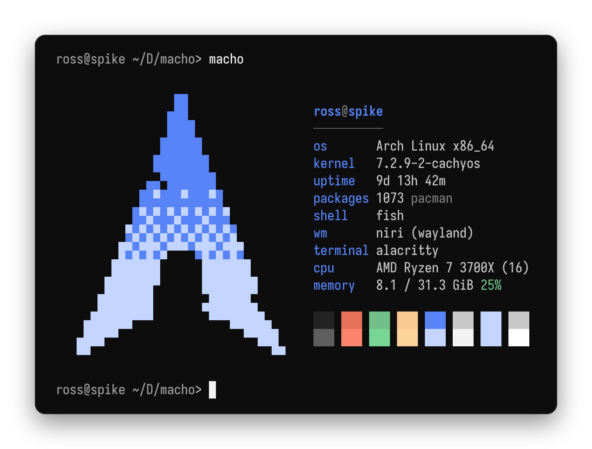
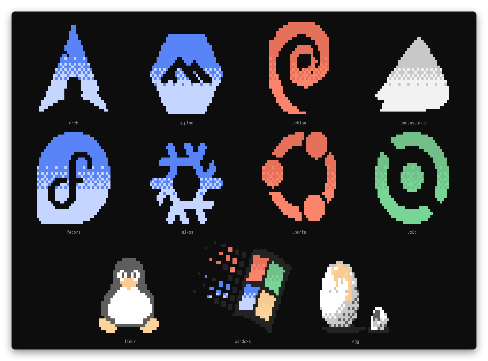
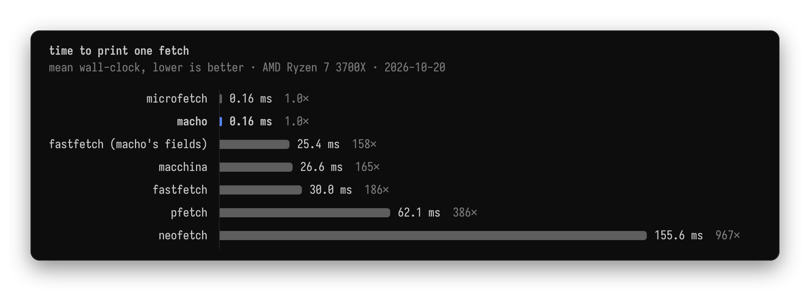
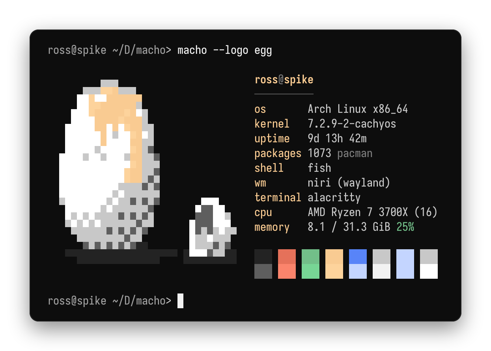

<div align="center">

# macho

**Quick on the draw.**

A small system fetch with solid block-art logos. No dependencies, no child processes,
one static binary.

[](https://github.com/RossAnder/macho/actions/workflows/ci.yml)
[](#license)

<picture>
  <source media="(prefers-color-scheme: light)" srcset="assets/macho-light.png">
  
</picture>

</div>

## Why

- **Fast.** Everything is read straight from `/proc`, `/sys`, `os-release` and the
  environment, one `read` per file, and hostname, kernel and uptime come from `uname`
  and the boot clock without opening anything. macho never spawns a process and links
  neither Rust's standard library nor libc: it makes its own system calls, allocates
  from a static arena, and draws logos that were rendered at compile time. See the
  [benchmarks](#benchmarks).
- **Solid logos.** Logos are small pixel bitmaps drawn with half-block characters, so
  each terminal cell holds two pixels, and shaded logos dither into their bright colour
  down their height.
- **Themed by your terminal.** Logo colours are ANSI palette indices rather than fixed
  RGB, so the art takes on whatever theme your terminal runs.
- **Quiet.** A missing source drops its line instead of printing an error, and
  `NO_COLOR` is respected.

## Install

From source, with a Rust toolchain no older than the `rust-version` in
[`Cargo.toml`](Cargo.toml):

```sh
cargo install --locked --git https://github.com/RossAnder/macho
```

That builds the same static binary as a checkout does. macho runs on Linux, on x86-64
and aarch64.

With a nightly toolchain, `cargo +nightly tiny` makes the same binary about a fifth
smaller, by rebuilding `core` and `alloc` for size (it needs
`rustup component add rust-src --toolchain nightly`). It starts no faster. The binary
lands in `target/x86_64-unknown-linux-gnu/tiny/`.

Tagged [releases](https://github.com/RossAnder/macho/releases) attach prebuilt
binaries for x86-64 and aarch64, which run on any distribution.

## Usage

```sh
macho                  # detect the distribution and pick its logo
macho --logo egg       # any logo by name
macho --list-logos     # the names --logo accepts
NO_COLOR=1 macho       # plain text
```

`macho --help` lists every option. To greet each new shell, add `macho` to the end of
your shell's interactive startup file (for fish, an `if status is-interactive` block in
`config.fish`).

## Logos

macho matches the `ID` in `os-release` first, then each `ID_LIKE` entry in turn, so
derivatives land on their parent's logo (CachyOS on Arch, Mint on Ubuntu), and anything
unrecognised gets Tux. Some logos are only reachable with `--logo`.

<picture>
  <source media="(prefers-color-scheme: light)" srcset="assets/logos-light.png">
  
</picture>

To add your own, see [CONTRIBUTING.md](CONTRIBUTING.md#adding-a-logo).

## Benchmarks

<picture>
  <source media="(prefers-color-scheme: light)" srcset="assets/bench-light.png">
  
</picture>

On the machine above (2026-10-20), macho printed a fetch in 0.16 ms, within 1% of
microfetch while also counting packages and finding the shell, terminal and desktop,
and roughly 150–950× faster than fastfetch, macchina, pfetch and neofetch, including
fastfetch limited to the same fields. Method, versions and the full table
are in [docs/benchmarks.md](docs/benchmarks.md); `scripts/bench.sh` reruns it on your
machine.

## Screenshots

These images are real `macho` output, rendered by `scripts/screenshots.py` in the
*eggshell* dark and light palettes with IosevkaTerm. Because the logos use your palette,
the same egg looks like this in eggshell:

<picture>
  <source media="(prefers-color-scheme: light)" srcset="assets/egg-light.png">
  
</picture>

## License

Licensed under either of

- Apache License, Version 2.0 ([LICENSE-APACHE](LICENSE-APACHE))
- MIT license ([LICENSE-MIT](LICENSE-MIT))

at your option.

Unless you explicitly state otherwise, any contribution intentionally submitted for
inclusion in the work by you, as defined in the Apache-2.0 license, shall be dual
licensed as above, without any additional terms or conditions.
